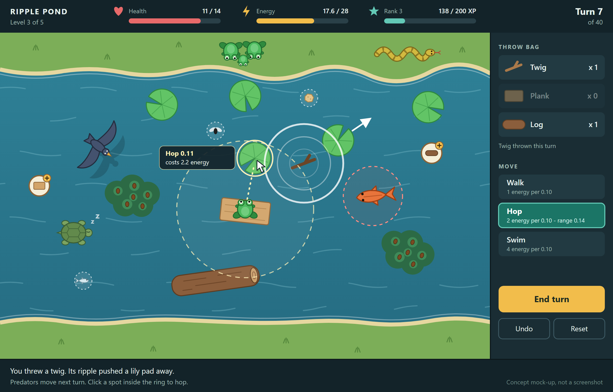

# Ripple Pond

A turn-based 2D game in Java. A young frog must cross a river to reach its family on
the far bank. You throw things into the water: each one floats where it lands, gives
the frog something to walk on, and sends out a ripple that pushes everything floating
nearby. Snakes, birds and fish hunt the frog, every move costs energy, and each river
crossed makes the frog stronger.



*Concept mock-up of the level screen, not a screenshot of the running game.*

Epitech project T-JAV-501, "2D Game". The goal of the project is to put object-oriented
design into practice: UML, design patterns, unit tests with coverage, and Javadoc.

## Status

As of 20 November 2026 the design is complete and the code is not started. This
repository holds the design documents only. Delivery is on 28 November 2026.

| Deliverable | State |
| --- | --- |
| Game Design Document | Draft 4, under team review |
| Task lists with due dates | Written, waiting for the team to confirm |
| UML class diagram | Version 2 |
| Maven project, CI, coverage | Not in the repository yet |
| Game model and tests | Not started |
| JavaFX interface | Not started |
| Javadoc | Not started |

Update this section as the milestones below are reached.

## How the game plays

The view is top-down. There is no grid: every object is a circle with a position and a
size measured in widths of the play area. The play area always keeps a 3:2 shape, so
the game scales with the window but no distance in the game changes. Nothing moves
while you think.

Each turn runs five steps, always in this order:

1. **Throw (optional).** Pick an object from your bag and click a point on the water.
   It lands there, floats, and starts a ripple.
2. **Ripples spread.** Every ripple grows outward as a circle, then fades after a few
   turns. Reed clumps block ripples.
3. **Objects react.** A ripple pushes each floating object once, when its ring passes
   it, away from where it started. Sleeping turtles wake and move. A frog standing on a
   pushed object rides along with it.
4. **The frog moves (optional).** One move per turn: walk, hop or swim.
5. **Predators act.** Predators chase the frog. They move on every second turn, but can
   attack on any turn.

### The frog

| | |
| --- | --- |
| Health | Lost to predators. At 0 the level is lost. |
| Energy | Spent by moving, in proportion to the distance. At 0 the level is lost. |
| Walk | Along a bank or the object the frog is standing on. The cheapest move. |
| Hop | A jump across water to another surface. Costs 2 times as much as walking. |
| Swim | Through open water. Costs 4 times as much as walking, and must be unlocked. |

Health and energy are refilled at the start of every level.

### What is in the river

| Thing | What it does |
| --- | --- |
| Thrown objects | Come in several sizes; a bigger one gives the frog more room to walk. You gather more by touching their icons in the level. |
| Lily pads | Float, can be stood on, and are pushed by ripples. |
| Turtles | Sleep on the bottom and block the way until a ripple wakes them. |
| Reed clumps | Solid. They block ripples, floating objects and the frog. |
| Snakes, birds, fish | Predators. They chase the frog and damage it when it is in reach. |
| Flies | Restore health and energy. |
| Small minnows | Restore energy. |
| Breadcrumbs | Restore health. |

### Winning, losing and growing

You win a level when the frog reaches the far bank. You lose if its health or energy
runs out, or if the turn limit is reached. Running out of things to throw is not a
loss: the frog may still walk or hop across. A lost level can be retried with Reset.

Finishing a level earns experience: a fixed amount, plus a bonus for the health and
energy the frog has left. As experience grows the frog gains ranks. Each rank lets it
hop further and raises its maximum health and energy, and a later rank lets it swim.

The core game has five levels, played in order.

### Controls

| Action | How |
| --- | --- |
| Throw an object | Pick it in the throw bag, then click a point on the water |
| Move the frog | Choose walk, hop or swim, then click a destination |
| Finish the turn | Click **End turn** |
| Restart the level | **Reset** button |
| Quit | Esc |

The game is played in a JavaFX window only. Undo is a stretch goal; the mock-up shows
its button, but it is in the game only if there is time to build it.

All balancing numbers (health, energy, damage, ranges, experience) are starting values
in the Game Design Document and will be tuned by playtesting.

## Built with

| Tool | Used for |
| --- | --- |
| Java 21 | Language |
| JavaFX | Graphical interface |
| Maven | Build |
| JUnit 5 | Unit tests |
| JaCoCo | Test coverage (target: 80% of lines in the game model) |
| Javadoc | Code documentation |
| GitHub Actions | Runs the tests on every push |

## Build, run and test

The Maven project is not in the repository yet, so nothing below can be run today.
These are the commands the chosen tools normally use. Check them against `pom.xml` once
it is committed, and correct this section if they differ.

You will need a JDK 21 and Maven 3.9 or later.

| To | Run | Result |
| --- | --- | --- |
| Run the tests | `mvn test` | Test results in the console |
| Run the tests with coverage | `mvn verify` | Coverage report, normally `target/site/jacoco/index.html` |
| Start the game | `mvn javafx:run` | Opens the game window (needs the JavaFX Maven plugin) |
| Generate the Javadoc | `mvn javadoc:javadoc` | HTML documentation under `target/` |

## Design

The rules live in a game model that never imports JavaFX, so every rule can be unit
tested without opening a window. Views only listen to the model; controllers turn
clicks into actions. Section 8.2 of the Game Design Document lists the object-oriented
principles every class must follow, and reviewers check each merge against it.

Everything in the river shares a position and a size and differs in how it behaves.
That family of classes is the main place the project shows object-oriented design.

| Pattern | Where it appears |
| --- | --- |
| Template method | Every element reacts to a ripple through one fixed method and fills in only its own step |
| Strategy | The three ways of moving, how a ripple spreads, how a predator chases |
| Factory | Level files name objects as text; one class turns names into objects |
| Observer | Views listen for events such as "object pushed" or "frog hurt" |
| State | A level is in progress, won or lost, and only a level in progress accepts turns |

The full design, in four views, is in the
[UML class diagram](docs/RIPPLE_POND_UML.md).

## Documents

| Document | File |
| --- | --- |
| Game Design Document, editable source | [docs/RIPPLE_POND_GDD.md](docs/RIPPLE_POND_GDD.md) |
| Game Design Document, Draft 4, PDF | [docs/RIPPLE_POND_GDD_REV_4.pdf](docs/RIPPLE_POND_GDD_REV_4.pdf) |
| UML class diagram, editable source | [docs/RIPPLE_POND_UML.md](docs/RIPPLE_POND_UML.md) |
| UML class diagram, version 2, PDF | [docs/RIPPLE_POND_UML_REV_2.pdf](docs/RIPPLE_POND_UML_REV_2.pdf) |
| Level screen mock-up | [docs/RIPPLE_POND_MOCKUP.png](docs/RIPPLE_POND_MOCKUP.png) |
| Stephan's tasks | [docs/tasks/TASKS_STEPHAN.md](docs/tasks/TASKS_STEPHAN.md) |
| Jonathan's tasks | [docs/tasks/TASKS_JONATHAN.md](docs/tasks/TASKS_JONATHAN.md) |
| Zaryab's tasks | [docs/tasks/TASKS_ZARYAB.md](docs/tasks/TASKS_ZARYAB.md) |

Edit the Markdown sources, never the PDFs. When a design change produces a new PDF, the
old one is kept and the new one gets the next revision suffix, for example `_REV_3`.
Earlier revisions stay in `docs/` for reference. To export new PDFs on Windows (needs
Edge or Chrome and an internet connection):

```
powershell -ExecutionPolicy Bypass -File tools\make-doc-pdfs.ps1 -Doc All
```

`-Doc GDD` or `-Doc UML` exports only one document.

## Repository layout

| Path | Contents |
| --- | --- |
| `README.md` | This file |
| `docs/` | Design documents: Markdown sources, PDF revisions and the mock-up |
| `docs/tasks/` | Each member's step-by-step tasks with due dates |
| `tools/make-doc-pdfs.ps1` | Exports the design documents to new PDF revisions |
| `pom.xml`, `src/main/java`, `src/test/java` | Planned: the Maven project, the game and its tests |
| `CREDITS.md` | Planned: every third-party asset and its licence |

## Team

Roles for the systems added in Drafts 2 and 3 are proposed and waiting for the team to
confirm.

| Member | Load | Owns |
| --- | --- | --- |
| Stephan (lead) | Full | Geometry, ripple engine and turn loop, predators, the JavaFX window and level screen, levels 3 and 4, Maven and CI, integration |
| Jonathan | Full | The frog (health, energy, movement, experience and ranks), thrown objects, lily pads, turtles and reed clumps, level states, the level loader and file format, the game session and reset, levels 1 and 2, GDD and UML |
| Zaryab | Light | The title, level complete and game over screens, food, level 5, playtesting all levels, this README and the How to Play text |

### Working rules

- A merge is the class, its unit tests and its Javadoc together.
- Every merge is reviewed by one teammate, against the object-oriented principles in
  section 8.2 of the Game Design Document. Each person reviews code they did not write.
- The team writes the code with AI assistance. Everyone must be able to explain every
  line they merge.
- The main branch always builds and its tests pass.

## Milestones

Re-planned on 20 November, because work starts on 21 November. Each member's tasks are
in `docs/tasks/`.

| Date | Goal |
| --- | --- |
| Sat 21 Nov | Maven project, CI and shared types in `main` by 12:00. Level file format written |
| Sun 22 Nov | Foundations done: geometry, ripples, element hierarchy, frog health and energy, level states, all tested |
| Mon 23 Nov | Turn engine, level loader, movement and food. The JavaFX window switches screens |
| Tue 24 Nov | Full turn loop runs end to end in tests. JavaFX level screen shows the river and accepts clicks |
| Wed 25 Nov | Five levels by 12:00. Playtest in the afternoon, balancing session at 19:00 |
| Thu 26 Nov | Feature freeze at 18:00. Javadoc complete, coverage reviewed, UML and GDD updated to match the code |
| Fri 27 Nov | Demo rehearsal and presentation preparation |
| Sat 28 Nov | Delivery |

## Still open

Several design points are not decided yet, among them which objects can be thrown,
whether ripples affect predators, and how walking differs from hopping. Section 10 of
the Game Design Document has the full list, and what was decided since Draft 2.

## Credits

The game concept, rules and documents are the team's own. No existing game is copied.

The design documents (Game Design Document, UML class diagram and mock-up) were drafted
with AI assistance from the team's decisions. The code is written by the team with AI
assistance, and every member can explain each line they merged.

Third-party art, if any is used, will be listed with its licence in `CREDITS.md`.
