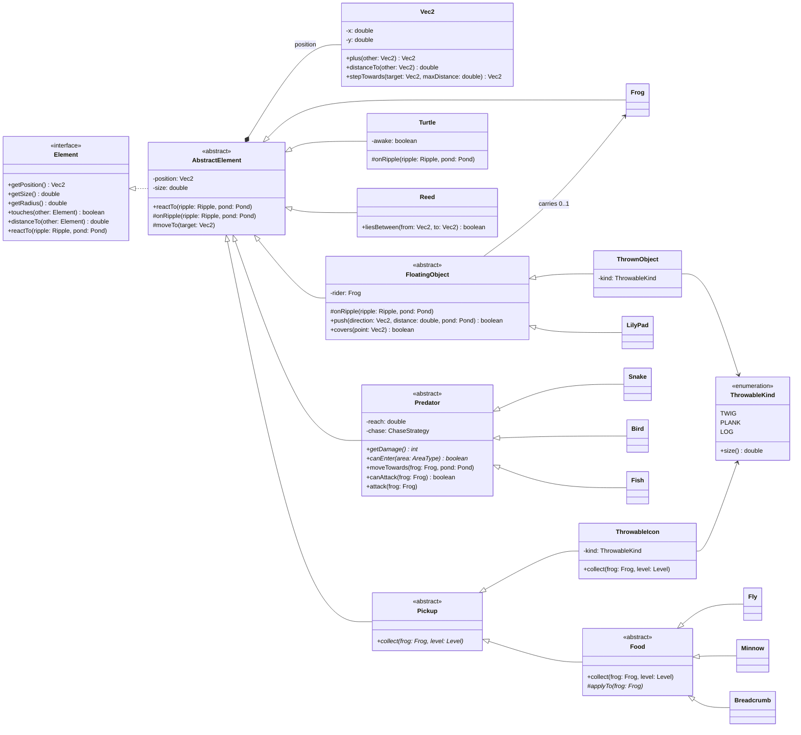
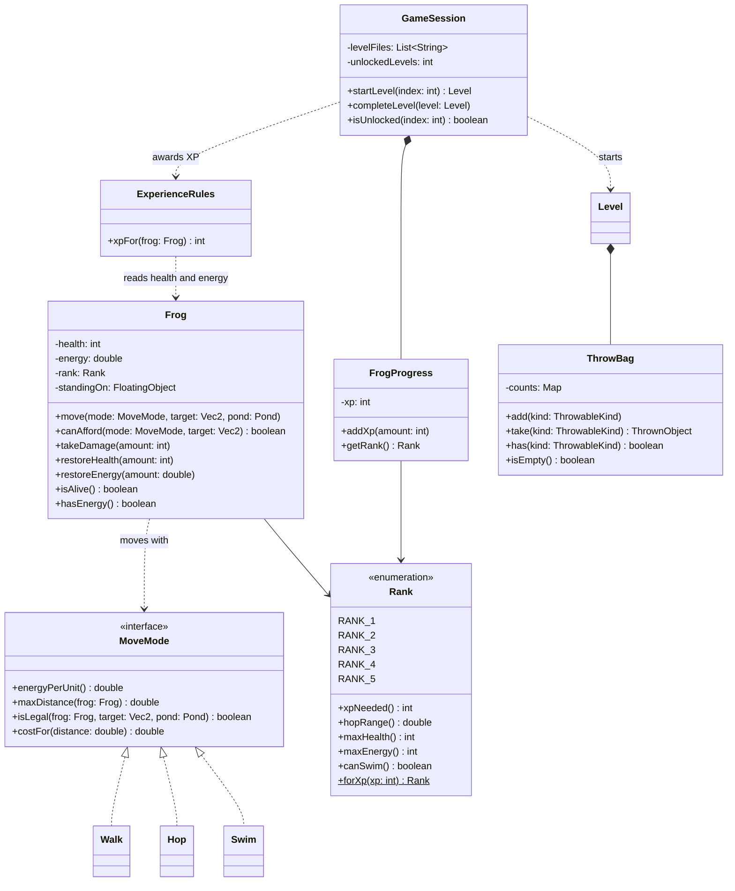
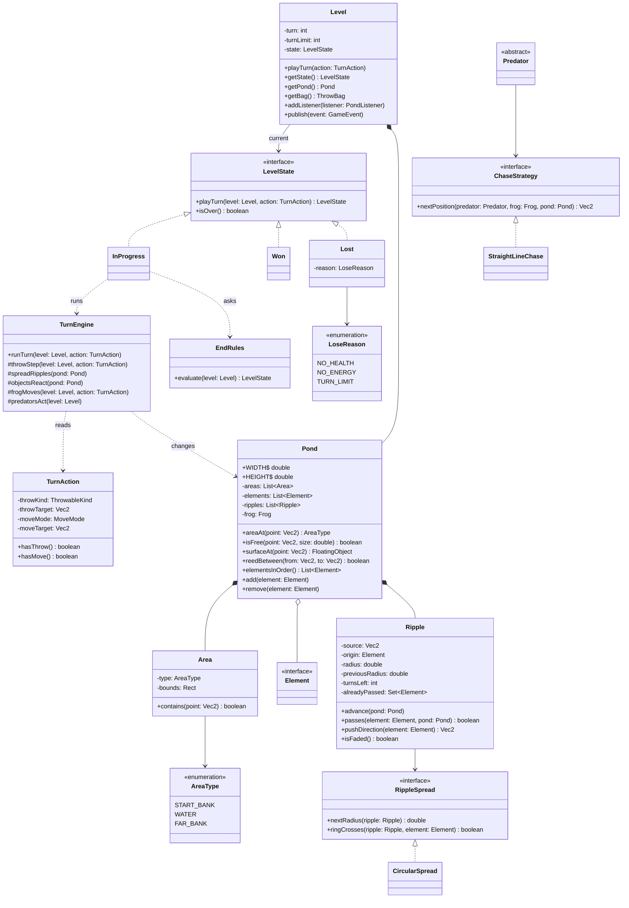
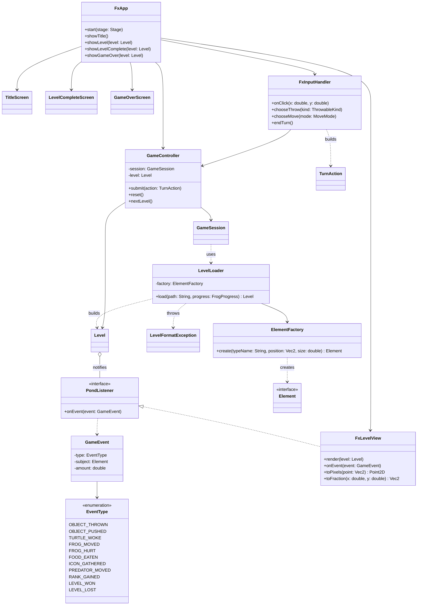

# Ripple Pond - UML class diagram

Version 2, 20 November 2026. Matches Draft 3 of the Game Design Document.

This file is the editable source of the class diagram. The diagrams are written in
Mermaid, which GitHub, IntelliJ IDEA and VS Code (with a Mermaid extension) render
directly. Edit the text between the code fences and the picture follows. When it
changes, export a new PDF revision (`RIPPLE_POND_UML_REV_n.pdf`) and keep the old ones.

All positions and sizes are in play-area widths: x runs from 0 to 1 and y from 0 to
0.667, so a distance means the same in every direction. Every element is a circle and
its size is its diameter (GDD section 2.1).

The design is split into four views, because one picture of every class would be
unreadable. A class can appear in more than one view; its members are listed only in
the view where it matters most.

How to read the arrows:

| Arrow | Meaning |
| --- | --- |
| `A <\|-- B` (solid line, hollow triangle) | B extends A |
| `A <\|.. B` (dashed line, hollow triangle) | B implements interface A |
| `A *-- B` (filled diamond) | A owns B; B does not exist without A |
| `A o-- B` (hollow diamond) | A holds B, but B can exist without A |
| `A --> B` (solid arrow) | A keeps a reference to B |
| `A ..> B` (dashed arrow) | A uses B for a moment (parameter, creates, throws) |

Members: `+` public, `#` protected, `-` private. Italic (written with a trailing `*`)
means abstract. Underlined (trailing `$`) means static.

## 1. Elements: everything that sits in the river

Every thing in the river is an `Element` with a position and a size. Subclasses exist
where behaviour differs. Thrown objects differ only in size, so they are one class with
a `ThrowableKind` value rather than three subclasses.

Notes:

- `getSize` is the diameter and `getRadius` half of it. `touches` is true when the
  distance between centres is no more than the sum of the radii.
- `AbstractElement.reactTo` is the same for every element: it asks the ripple whether
  its ring passes the element this turn and, if so, calls `onRipple`. Subclasses only
  override `onRipple`. A floating object is pushed, a turtle wakes and moves, everything
  else ignores it.
- `FloatingObject.push` moves its `rider` with it. This is the riding rule.
- `Reed` is a solid clump that never moves. `liesBetween` answers whether the clump is
  on the straight line between two points; the ripple uses it for the reed shadow rule.
- `Snake`, `Bird` and `Fish` each answer `getDamage` and `canEnter` differently.
- `Fly`, `Minnow` and `Breadcrumb` each implement `applyTo` (health, energy or both).

## 2. The frog: movement, energy and experience

The three ways of moving are separate classes behind one interface. The frog asks the
chosen `MoveMode` whether a move is legal and what it costs.

Notes:

- `Walk`, `Hop` and `Swim` return 1, 2 and 4 from `energyPerUnit`. `Hop.maxDistance`
  reads the frog's rank; `Swim.isLegal` checks `Rank.canSwim`.
- `Rank` holds the table from section 4.3 of the GDD as data.
- `FrogProgress` lives in the `GameSession`, so experience survives from level to level.
  A `Frog` is created fresh for each level with full health and energy for its rank.

## 3. The turn engine, ripples and level state

`Level.playTurn` hands the action to the current `LevelState`. Only `InProgress` runs
the `TurnEngine`; `Won` and `Lost` refuse further turns.

Notes:

- `TurnEngine.runTurn` always calls the five steps in the order of section 3 of the GDD:
  throw, ripples spread, objects react, frog moves, predators act.
- `predatorsAct` moves predators on every second turn only, but lets them attack on
  every turn.
- `Pond.elementsInOrder` returns elements top to bottom, then left to right, so the
  result is always the same for the same input.
- `Pond.WIDTH` is 1 and `Pond.HEIGHT` is 0.667: the play area's fixed 3:2 shape.
- `Ripple.passes` is true only in the turn the ring first reaches the element's nearest
  edge (`RippleSpread.ringCrosses`, comparing `previousRadius` and `radius`), only if
  `Pond.reedBetween` finds no reed clump on the line from the source, and only once per
  element: the element is then recorded in `alreadyPassed`. It is never true for
  `origin`, the thrown object that started the ripple.
- `EndRules.evaluate` returns `Won`, `Lost` (with a reason) or `InProgress`. Win is
  checked after the frog moves; health, energy and the turn limit after predators act.

## 4. Loading levels, events, views and controllers

The model never imports JavaFX. Views learn about changes by listening for events.

Notes:

- `ElementFactory.create` turns a type name from the level file (`log`, `snake`, `fly`)
  into the right `Element` subclass. An unknown name becomes a `LevelFormatException`.
- `FxLevelView.toPixels` and `toFraction` are the only place where play-area widths
  become pixels and back. They use one scale factor for both axes, so the play area keeps
  its 3:2 shape and a bigger window cannot change a distance in the game.
- The model only knows the `PondListener` interface, never `FxLevelView`. Tests attach
  their own listener to check which events a turn produced.
- `TitleScreen`, `LevelCompleteScreen` and `GameOverScreen` are the simple screens of GDD
  section 5. JavaFX is the only interface; the console version was dropped.
- `GameController.reset` reloads the current level file. Undo is a stretch goal and is
  not modelled.

## Design patterns and where to find them

| Pattern | Classes | What it buys |
| --- | --- | --- |
| Template method | `AbstractElement.reactTo` calling `onRipple`; `Food.collect` calling `applyTo`; `TurnEngine.runTurn` calling its five steps | The fixed part is written once; each subclass fills in only its own step |
| Strategy | `MoveMode` (Walk, Hop, Swim); `RippleSpread` (CircularSpread); `ChaseStrategy` (StraightLineChase) | A rule can be swapped or added without touching the class that uses it |
| Factory | `ElementFactory`, used by `LevelLoader` | Level files name types as text; one place maps names to classes |
| Observer | `PondListener`, `GameEvent`, `Level.addListener` and `publish` | The model stays free of any view code; the JavaFX view and the tests listen the same way |
| State | `LevelState` (InProgress, Won, Lost) | A finished level cannot accept turns, with no `if` chains in `Level` |

## Where this differs from the GDD, and what is still open

- `ThrowableKind` uses the placeholder names twig, plank and log (GDD section 10).
- `StraightLineChase` is the simple rule proposed in the GDD. A smarter rule that goes
  around reed clumps would be a second `ChaseStrategy`, with no change to `Predator`.
- Undo is a stretch goal and is not modelled. If it is built, a turn's changes could be
  recorded as commands that can be reversed, without changing the classes above.
- Method lists show the operations that matter for the design. Getters, setters and
  constructors are left out.

Changed since version 1, to match Draft 3 of the GDD:

- Reed clumps are a `Reed` element instead of an area type; `AreaType` lost `REEDS`.
- `Ripple.reaches` became `passes`, which is true once per element, when the ring passes
  it. `Pond.reedBetween` supports the reed shadow rule.
- `LoseReason` lost `NO_MOVES`: a level is lost only on health, energy or the turn limit.
- `Pond.WIDTH` and `HEIGHT` fix the play area's 3:2 shape; `Element.getRadius` added.
- The console classes (`ConsoleApp`, `ConsoleView`, `CommandParser`) are removed. The
  title, level complete and game over screens are added.
- `Level` is now listed in the GDD as a shared class, not an interface, so the two
  documents agree.
