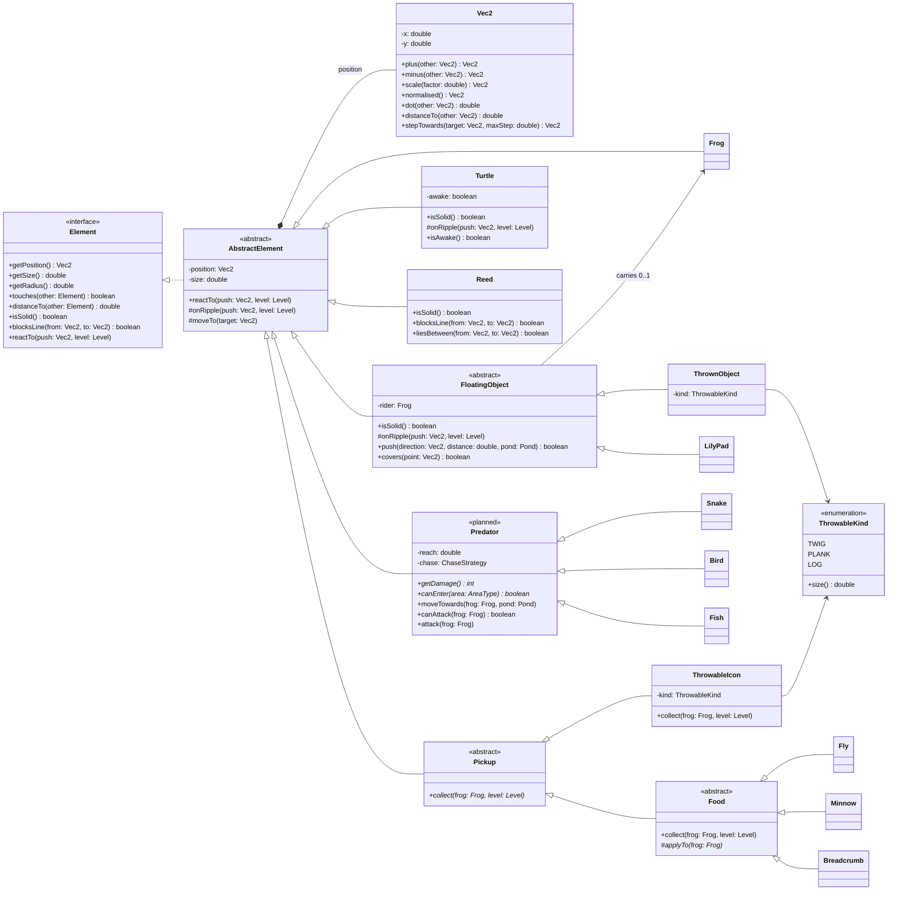
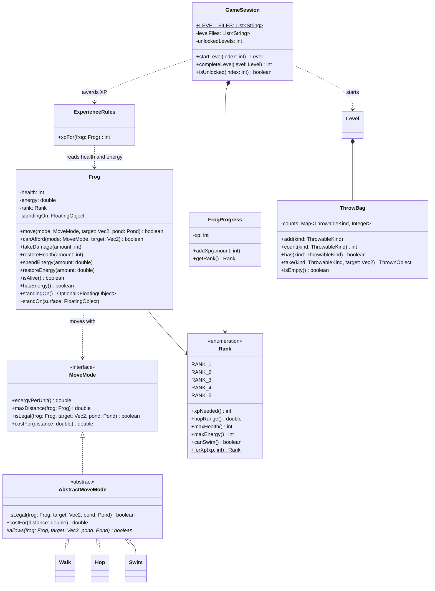
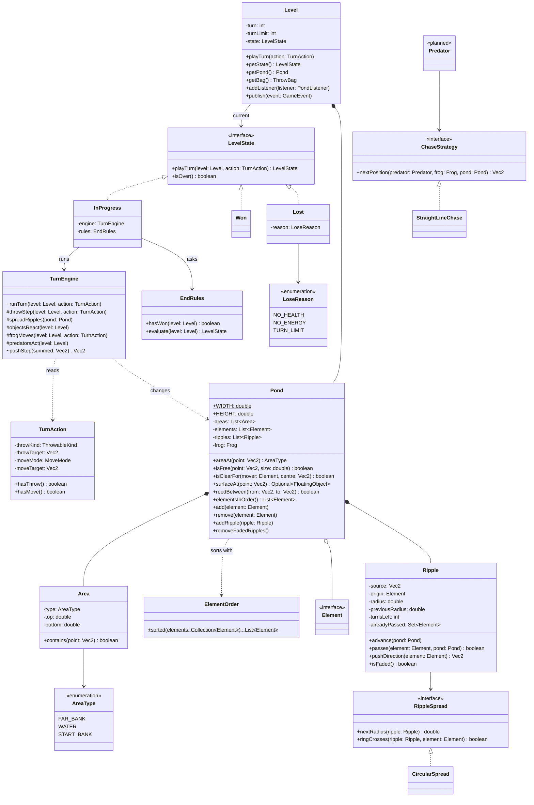
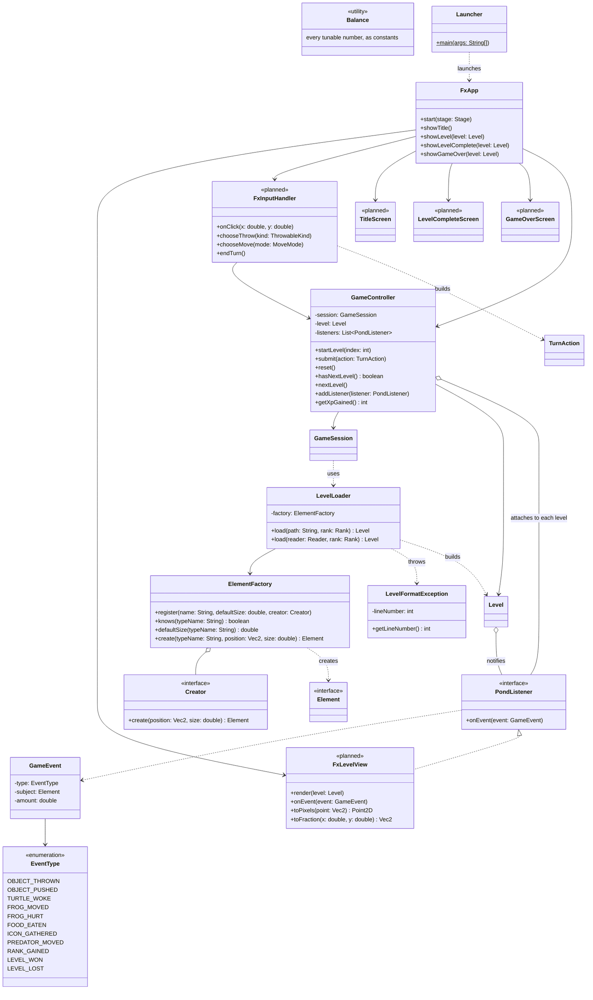

# Ripple Pond - UML class diagram

Version 3, 25 November 2026. Matches Draft 5 of the Game Design Document and the code in
`main` on 25 November (tasks S1 to S5, J1 to J9, X1, X3 and X4).

This file is the editable source of the class diagram. The diagrams are written in
Mermaid, which GitHub, IntelliJ IDEA and VS Code (with a Mermaid extension) render
directly. Edit the text between the code fences and the picture follows. When it
changes, export a new PDF revision (`RIPPLE_POND_UML_REV_n.pdf`) and keep the old ones.

All positions and sizes are in play-area widths: x runs from 0 to 1 and y from 0 to
2/3, so a distance means the same in every direction. Every element is a circle and
its size is its diameter (GDD section 2.1).

The design is split into four views, because one picture of every class would be
unreadable. A class can appear in more than one view; its members are listed only in
the view where it matters most.

Classes that are designed but not written yet are marked `<<planned>>`: the predators
(task S6), the level screen and input (S7, S8) and the three end screens (X2).

How to read the arrows:

| Arrow | Meaning |
| --- | --- |
| `A <\|-- B` (solid line, hollow triangle) | B extends A |
| `A <\|.. B` (dashed line, hollow triangle) | B implements interface A |
| `A *-- B` (filled diamond) | A owns B; B does not exist without A |
| `A o-- B` (hollow diamond) | A holds B, but B can exist without A |
| `A --> B` (solid arrow) | A keeps a reference to B |
| `A ..> B` (dashed arrow) | A uses B for a moment (parameter, creates, throws) |

Members: `+` public, `#` protected, `~` package-private, `-` private. Italic (written
with a trailing `*`) means abstract. Underlined (trailing `$`) means static.

## 1. Elements: everything that sits in the river

Every thing in the river is an `Element` with a position and a size. Subclasses exist
where behaviour differs. Thrown objects differ only in size, so they are one class with
a `ThrowableKind` value rather than three subclasses.

Notes:

- `getSize` is the diameter and `getRadius` half of it. `touches` is true when the
  distance between centres is no more than the sum of the radii.
- Reacting to ripples is a Template method. The turn engine works out which ripples
  passed an element this turn, adds up their pushes and calls `reactTo` once with the
  combined push. `AbstractElement.reactTo` is `final` and hands the push to `onRipple`,
  which does nothing by default. A floating object is pushed (and publishes
  `OBJECT_PUSHED`), a turtle wakes and moves (and publishes `TURTLE_WOKE` the first
  time), everything else ignores it. `reactTo` gets the `Level` so each element can
  publish its own event.
- `isSolid` is a default method on `Element` that returns `false`. `Reed`, `Turtle` and
  `FloatingObject` return `true`: they block pushed objects and turtles. Pickups do not.
- `FloatingObject.push` moves its `rider` with it; this is the riding rule. The push is
  blocked, and nothing moves, if `Pond.isClearFor` says the new spot would overlap a
  solid element or reach onto a bank.
- `Reed` is a solid clump that never moves. `liesBetween` answers whether the clump is
  on the straight line between two points. `blocksLine` is a default method on
  `Element` that returns `false`; `Reed` overrides it with `liesBetween`, so
  `Pond.reedBetween` asks every element instead of checking for reeds by class. The
  ripple uses it for the reed shadow rule, and walking and swimming use it too.
- `Snake`, `Bird` and `Fish` each answer `getDamage` and `canEnter` differently. They are
  still empty classes until task S6.
- `Food.collect` is `final` (a Template method): restore, leave the pond, publish
  `FOOD_EATEN`. `Fly`, `Minnow` and `Breadcrumb` each implement only `applyTo`.
  `ThrowableIcon.collect` adds its kind to the throw bag and publishes `ICON_GATHERED`.

## 2. The frog: movement, energy and experience

The three ways of moving are separate classes behind one interface. The frog asks the
chosen `MoveMode` whether a move is legal and what it costs.

Notes:

- `AbstractMoveMode.isLegal` is a Template method and `final`: a move must go somewhere,
  stay within `maxDistance` (with a tiny allowance for decimal rounding) and inside the
  play area; only then does the subclass's `allows` decide. `costFor` is the same
  formula for every mode: energy per unit times the number of 0.10 units travelled.
- `Walk`, `Hop` and `Swim` return 1, 2 and 4 from `energyPerUnit`. Walk stays on the
  same bank or object; Hop goes from a surface to a surface and reads the frog's
  `hopRange`; Swim needs `Rank.canSwim` and one end of the move in the water. A reed
  clump blocks a walk or a swim, but a hop goes over it.
- `Frog.move` refuses an illegal or unaffordable move and changes nothing. Otherwise it
  pays, moves, and calls `standOn` with the floating object under the target (or none).
  `standOn` is package-private and keeps `standingOn` and the object's rider in step.
- `Rank` holds the table from section 4.3 of the GDD as data.
- `FrogProgress` lives in the `GameSession`, so experience survives from level to level.
  A `Frog` is created fresh for each level with full health and energy for its rank.
- `GameSession.completeLevel` accepts only the level being played, only once, and only
  if it is won. It returns the XP awarded, unlocks the next level and publishes
  `RANK_GAINED` when the rank rises.
- `ThrowBag.take` refuses a kind the bag does not hold, and returns the new object
  already placed at the throw target.

## 3. The turn engine, ripples and level state

`Level.playTurn` refuses a turn once the level is over, counts the turn, and hands it to
the current `LevelState`. Only `InProgress` runs the `TurnEngine`; `Won` and `Lost` refuse
further turns.

Notes:

- `TurnEngine.runTurn` always calls the five steps in the order of section 3 of the GDD:
  throw, ripples spread, objects react, frog moves, predators act. Faded ripples are
  removed at the end of the turn.
- `throwStep` takes the object from the bag with `take(kind, target)`, adds it to the
  pond and starts a ripple there. It is refused if the bag has none of that kind or
  `Pond.isFree` says the spot is not free open water (the frog included).
- `objectsReact` asks every ripple whether it `passes` each element, gives each ripple's
  push one push distance away from its source, adds them, caps the total at one push
  distance (`pushStep`), and calls `Element.reactTo` once per element.
- `frogMoves` calls `Frog.move`; a move that happens publishes `FROG_MOVED` and lets the
  frog collect every `Pickup` it touches.
- `runTurn` skips `predatorsAct` on the turn the frog reaches the far bank
  (`EndRules.hasWon`). `predatorsAct` (S6) will move predators on every second turn
  only, but let them attack on every turn. `ChaseStrategy` and `StraightLineChase` come
  with S6 too; they are empty classes now.
- A `Pond` always has a frog: its constructor refuses `null`.
- `Pond.elementsInOrder` returns elements top to bottom, then left to right
  (`ElementOrder`), so the result is always the same for the same input.
- `Pond.WIDTH` is 1 and `Pond.HEIGHT` is 2/3: the play area's fixed 3:2 shape.
- `Pond.isFree` places a new thrown object: no overlap with anything, the frog included.
  `Pond.isClearFor` moves an existing element: it ignores the mover itself and anything
  that is not solid, and allows just touching.
- `Ripple.passes` is true only in the turn the ring first reaches the element's nearest
  edge (`RippleSpread.ringCrosses`, comparing `previousRadius` and `radius`), only if
  `Pond.reedBetween` finds no reed clump on the line from the source, and only once per
  element: the element is then recorded in `alreadyPassed`. It is never true for
  `origin`, the thrown object that started the ripple.
- `EndRules.evaluate` returns `Won` if the frog is on the far bank, otherwise `Lost` with
  the first reason that applies (health, then energy, then the turn limit), otherwise
  the level's current state. Checking the win first means the last energy, or the last
  turn, can still win.

## 4. Loading levels, events, views and controllers

The model never imports JavaFX. Views learn about changes by listening for events.

Notes:

- `ElementFactory.create` turns a type name from the level file (`log`, `lilypad`,
  `fly`) into the right `Element` subclass through its registered `Creator`, usually a
  constructor reference such as `LilyPad::new`. Adding a type is one `register` line.
  An unknown name becomes a `LevelFormatException`, whose message starts with the line
  number. Icon lines (`icon <kind> x y`) name their kind first, so `LevelLoader` reads
  them itself.
- `LevelLoader.load` takes the frog's `Rank`; `GameSession` passes its progress's rank.
- `GameController` is the only class the view calls. `submit` completes a won level at
  once, so `getXpGained` and any new rank are known when the turn ends. `reset` reloads
  the current level file and keeps the XP. The listeners it holds are attached again to
  every level it loads, so the view keeps hearing events after a reset.
- `FxApp` exists and opens the window; its `show...` methods, which switch screens,
  come with task S7.
- `FxLevelView.toPixels` and `toFraction` will be the only place where play-area widths
  become pixels and back. They use one scale factor for both axes, so the play area
  keeps its 3:2 shape and a bigger window cannot change a distance in the game.
- The model only knows the `PondListener` interface, never `FxLevelView`. Tests attach
  their own listener to check which events a turn produced.
- `TitleScreen`, `LevelCompleteScreen` and `GameOverScreen` are the simple screens of GDD
  section 5. JavaFX is the only interface; the console version was dropped.
- `Balance` holds every tunable number (sizes, costs, ripple strength, food, XP) as
  named constants, so the balancing session changes one file. `Rank` holds its own
  table.

## Design patterns and where to find them

| Pattern | Classes | What it buys |
| --- | --- | --- |
| Template method | `AbstractElement.reactTo` calling `onRipple`; `Food.collect` calling `applyTo`; `AbstractMoveMode.isLegal` calling `allows`; `TurnEngine.runTurn` calling its five steps | The fixed part is written once; each subclass fills in only its own step |
| Strategy | `MoveMode` (Walk, Hop, Swim); `RippleSpread` (CircularSpread); `ChaseStrategy` (StraightLineChase) | A rule can be swapped or added without touching the class that uses it |
| Factory | `ElementFactory` with its `Creator`s, used by `LevelLoader` | Level files name types as text; one place maps names to classes |
| Observer | `PondListener`, `GameEvent`, `Level.addListener` and `publish` | The model stays free of any view code; the JavaFX view and the tests listen the same way |
| State | `LevelState` (InProgress, Won, Lost) | A finished level cannot accept turns, with no `if` chains in `Level` |

## Where this differs from the GDD, and what is still open

- `ThrowableKind` uses the placeholder names twig, plank and log (GDD section 10).
- `StraightLineChase` is the simple rule proposed in the GDD. A smarter rule that goes
  around reed clumps would be a second `ChaseStrategy`, with no change to `Predator`.
- Four places still check a class with `instanceof` instead of asking the object:
  `Pond.surfaceAt` (FloatingObject), `TurnEngine` collecting pickups (Pickup), and
  `GameSession` and `GameController` checking for `Won`. Each has a polymorphic fix (for
  example `LevelState.isWon()`), like the one `blocksLine` already made for reeds; they
  are left for a clean-up.
- Undo is a stretch goal and is not modelled. If it is built, a turn's changes could be
  recorded as commands that can be reversed, without changing the classes above.
- Method lists show the operations that matter for the design. Getters, setters and
  constructors are left out.

Changed since version 2, to match the code:

- `Element.reactTo(Ripple, Pond)` became `reactTo(Vec2 push, Level level)`, called once
  per element with the combined push (agreed on pull request #9). `onRipple` changed to
  match, and `TurnEngine.objectsReact` takes the `Level`.
- `Element.isSolid` and `Pond.isClearFor` added for blocked pushes.
- `Element.blocksLine` added and overridden by `Reed`, so `Pond.reedBetween` no longer
  checks for reeds by class. `Pond` refuses a missing frog. `runTurn` skips the
  predators on the turn the frog wins.
- `AbstractMoveMode` added between `MoveMode` and the three modes.
- `Frog.move` returns whether the frog moved; `spendEnergy` and `standOn` added.
- `ThrowBag.take` takes the throw target; `count` added.
- `EndRules.hasWon` added; `evaluate` returns the current state when the level goes on.
- `Pond.surfaceAt` returns an `Optional`; `addRipple` and `removeFadedRipples` added.
  `ElementOrder` added. `Area` stores top and bottom instead of a `Rect`. `AreaType` is
  listed top to bottom.
- `LevelLoader.load` takes a `Rank` and can read from any `Reader`. `ElementFactory`
  gained `register`, `knows`, `defaultSize` and its `Creator`.
- `GameSession.completeLevel` returns the XP. `GameController` gained `startLevel`,
  `hasNextLevel`, `addListener` and `getXpGained`.
- `Vec2` lists `minus`, `scale`, `normalised` and `dot`. `Launcher` and `Balance` added.
- Classes not written yet are marked `<<planned>>`.

Changed in version 2, to match Draft 3 of the GDD:

- Reed clumps are a `Reed` element instead of an area type; `AreaType` lost `REEDS`.
- `Ripple.reaches` became `passes`, which is true once per element, when the ring passes
  it. `Pond.reedBetween` supports the reed shadow rule.
- `LoseReason` lost `NO_MOVES`: a level is lost only on health, energy or the turn limit.
- `Pond.WIDTH` and `HEIGHT` fix the play area's 3:2 shape; `Element.getRadius` added.
- The console classes (`ConsoleApp`, `ConsoleView`, `CommandParser`) are removed. The
  title, level complete and game over screens are added.
- `Level` is now listed in the GDD as a shared class, not an interface, so the two
  documents agree.
