# Banner & Blade — UML Design

| | |
|---|---|
| **Status** | Draft 2, written before any code; owners updated |
| **Date** | 18 November 2026 |
| **Source** | [Game Design Document](GDD.md), draft 3 |

The diagrams are written in Mermaid, which GitHub renders directly on this page. They describe the intended design. They must be updated to match the real code at the feature freeze (26 November).

A class that appears as an empty box in a diagram is detailed in another section.

**Contents**

1. [Package overview](#1-package-overview)
2. [Units, board and targeting](#2-units-board-and-targeting)
3. [Bonuses: modifiers, status effects, banners and items](#3-bonuses-modifiers-status-effects-banners-and-items)
4. [Combat and events](#4-combat-and-events)
5. [Match, warlords, draft and pairing](#5-match-warlords-draft-and-pairing)
6. [User interface](#6-user-interface)
7. [Match phases (state diagram)](#7-match-phases-state-diagram)
8. [One unit's turn in a tick (sequence diagram)](#8-one-units-turn-in-a-tick-sequence-diagram)
9. [Design patterns summary](#9-design-patterns-summary)

---

## 1. Package overview

The one rule that matters most: **nothing under `model` imports JavaFX.** The model can therefore run in unit tests and resolve off-screen fights instantly. The interface learns what happened through listener interfaces that the model defines.

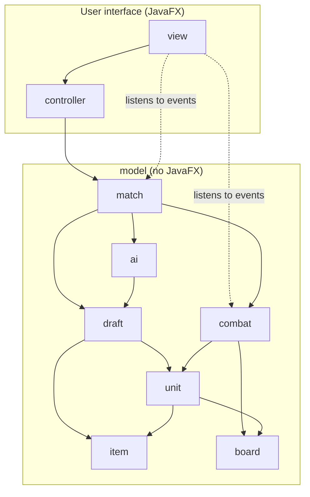

| Package | Contents | Foundation owner | Shared content |
|---|---|---|---|
| `model.board` | Grid, positions, pathfinding | Jonathan | None |
| `model.unit` | Unit hierarchy, stats, abilities, targeting, status effects, banners | Jonathan | The ten unit classes, status effects, targeting rules |
| `model.combat` | The fight loop, teams, results, combat events | Jonathan | None |
| `model.item` | Item hierarchy and item factory | Jonathan | The six effect items |
| `model.draft` | Draft offers and cards | Stephan | None |
| `model.match` | Match loop, phases, warlords, pairing, rules | Stephan (pairing: Jonathan) | None |
| `model.ai` | Rival strategies | Stephan | One strategy per member |
| `controller`, `view` | JavaFX screens and input handling | Stephan | Views split between all three |

Who writes each shared class is listed in GDD section 11.1.

---

## 2. Units, board and targeting

### 2.1 The unit hierarchy

`Unit.act()` is the fixed sequence every unit follows each tick (GDD section 4.3). It is `final`: this is the Template Method. Each subclass supplies only `castAbility()`. The two banner units share an intermediate class that owns the banner.

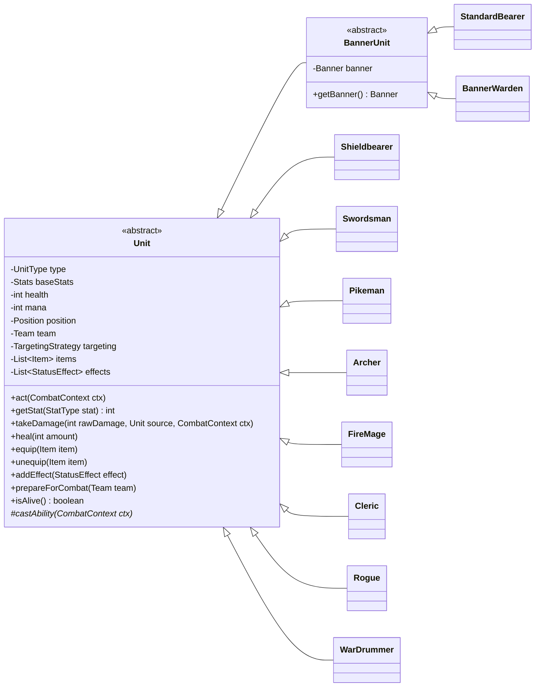

### 2.2 What a unit is built from

A unit is created by the factory from its type, carries its base stats, and delegates target selection to a strategy object. During a fight it sees the world only through the `CombatContext` interface.

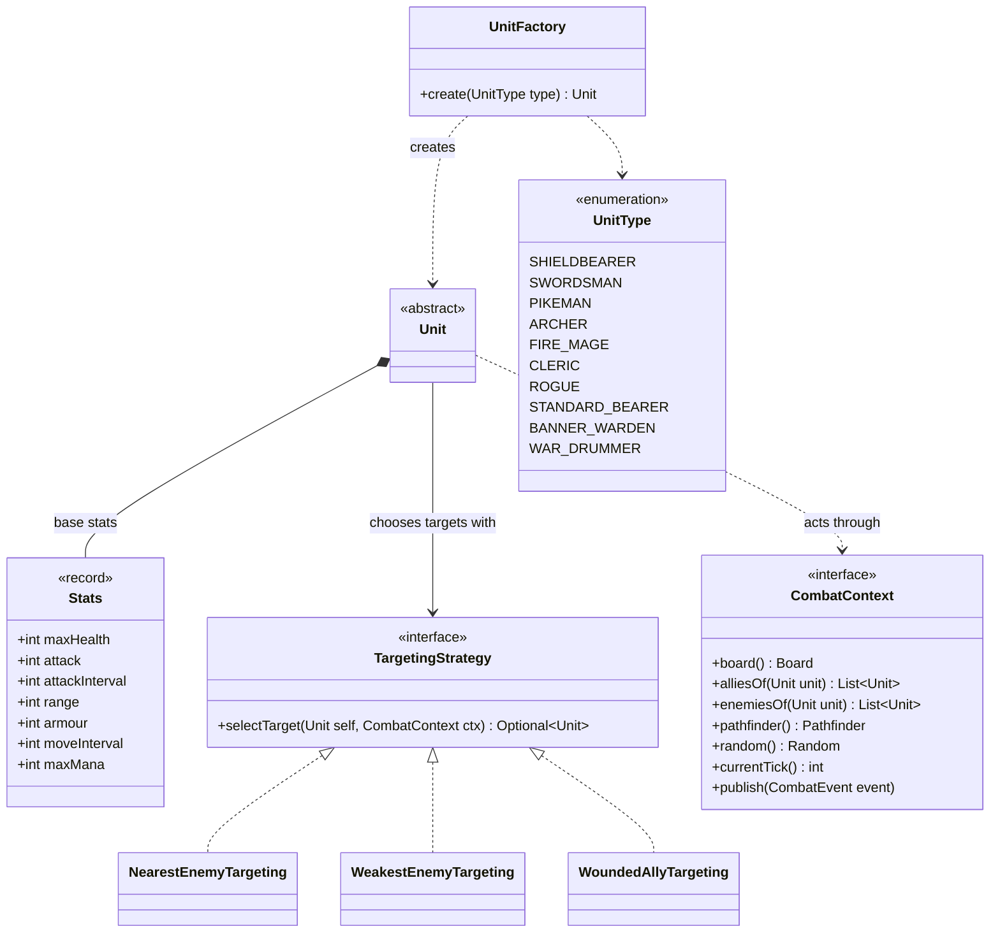

### 2.3 Board and pathfinding

`Position.distanceTo()` counts in 8 directions and is used for range. `Position.orthogonalNeighbours()` returns the 4 cells a unit may step to. Keeping both on `Position` puts the game's key spatial rule (GDD section 4.2) in one place.

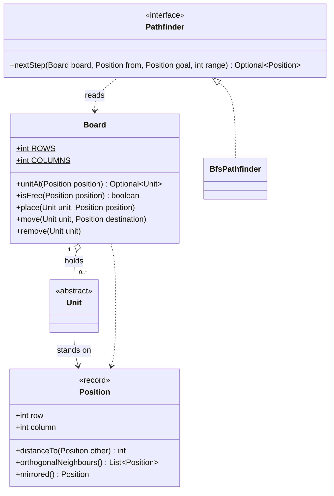

---

## 3. Bonuses: modifiers, status effects, banners and items

Everything that changes a stat — an item, a banner, a temporary buff — is a `ModifierSource`. `Unit.getStat()` starts from the base value and applies every modifier from the unit's items, its status effects and its team's banners. Because each source is counted separately, "everything stacks" (GDD section 6.1) needs no special code. Stretch-goal traits would be one more `ModifierSource`.

### 3.1 Modifiers, status effects and banners

`Banner.stackable` is false for the banners carried by banner units (only one per type counts for a team) and true for the Tattered Pennant.

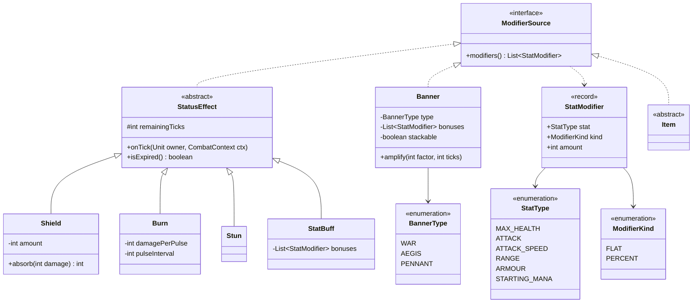

### 3.2 Items

Items that do more than change stats override the hook methods on `Item`, which do nothing by default. The five stat items are all instances of `StatItem` with different bonuses.

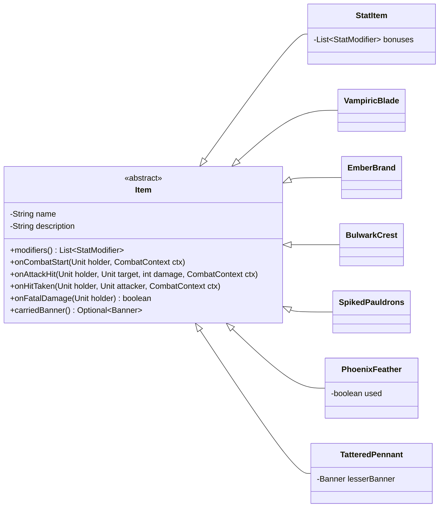

### 3.3 Who holds what

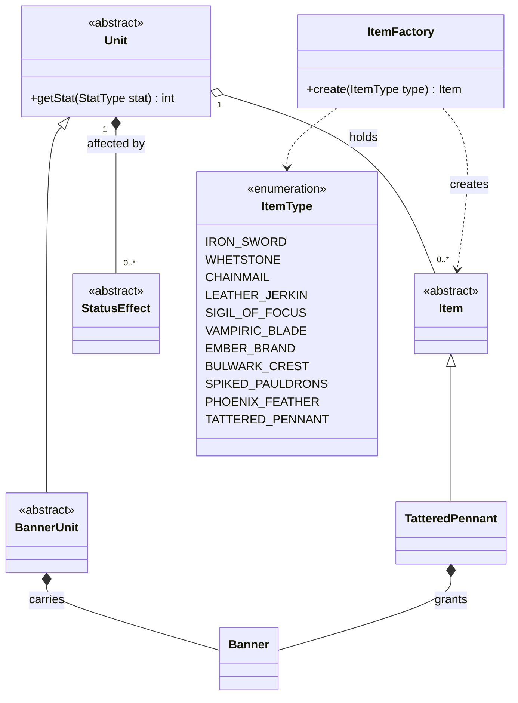

---

## 4. Combat and events

A `Combat` is one fight. The on-screen fight calls `tick()` once per animation step; off-screen fights call `runToEnd()`. Both use the same code, and the same seed always gives the same result. The away team's planned positions are mirrored onto the top half of the board.

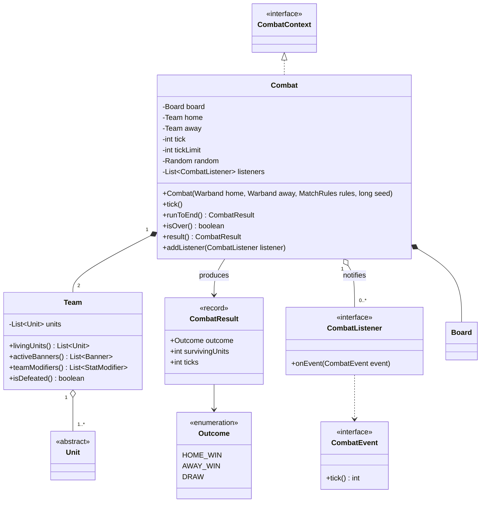

`CombatEvent` is implemented by small records, one per thing that can happen: `UnitMoved`, `UnitAttacked`, `UnitDamaged`, `UnitHealed`, `AbilityCast`, `UnitDied`, `BannerFell`, `CombatEnded`.

---

## 5. Match, warlords, draft and pairing

### 5.1 The match and its phases

`Match` holds the current `MatchPhase` and asks it what to do and what comes next. All balancing numbers live in `MatchRules`, so tests and balancing touch one class.

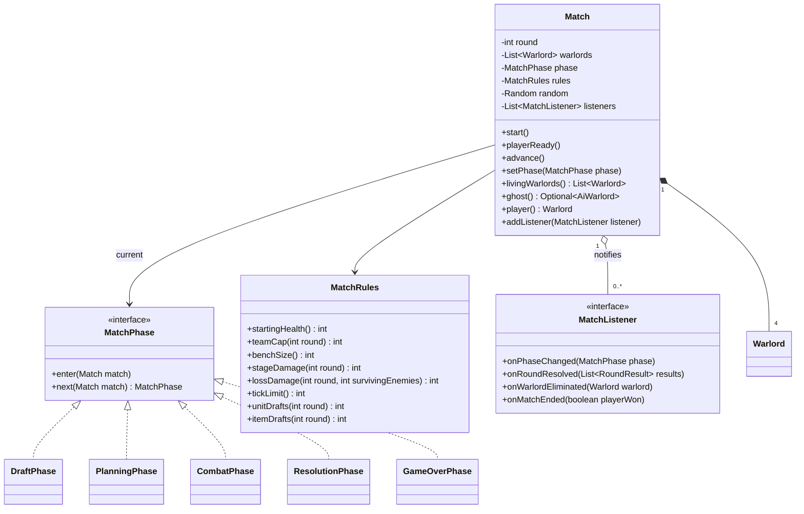

### 5.2 Warlords, warbands and AI rivals

The human player and the rivals are all `Warlord`s with a `Warband`. A rival adds a `RivalStrategy` that makes its choices. When a rival is eliminated its strategy keeps running each round, which is exactly what a ghost army is (GDD section 2.3): no separate ghost class is needed.

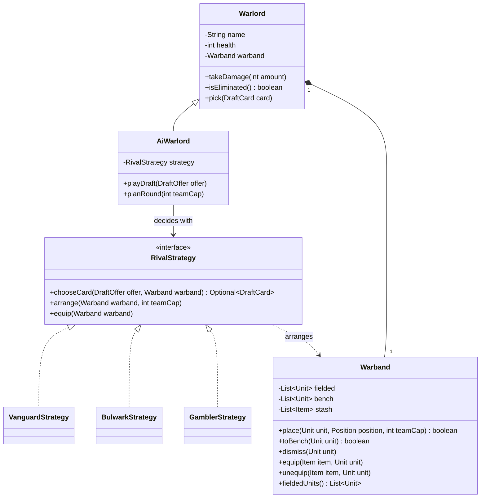

### 5.3 Draft and pairing

`PairingService` enforces the rule that no warlord meets the same opponent twice in a row unless it is the only one left, and brings in the ghost when three warlords are alive.

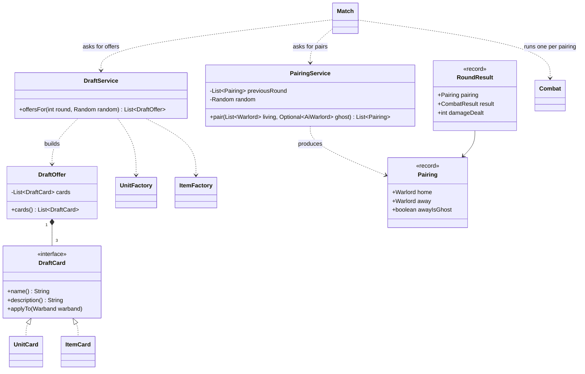

---

## 6. User interface

This part is indicative; Stephan, who owns the app shell, will shape it, and each view has its own author (GDD section 11.1). What is fixed is the direction of the arrows: the interface depends on the model, and hears about changes by implementing the model's listener interfaces.

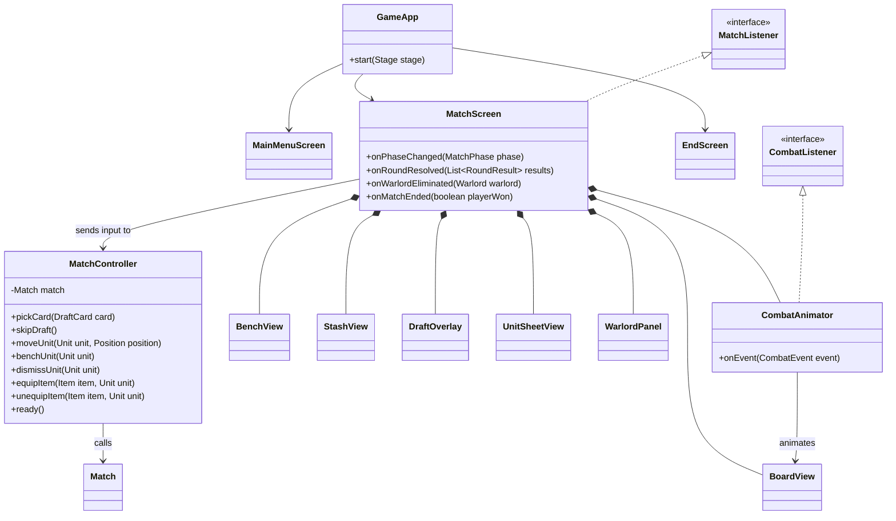

---

## 7. Match phases (state diagram)

Each state is one `MatchPhase` class from section 5.1.

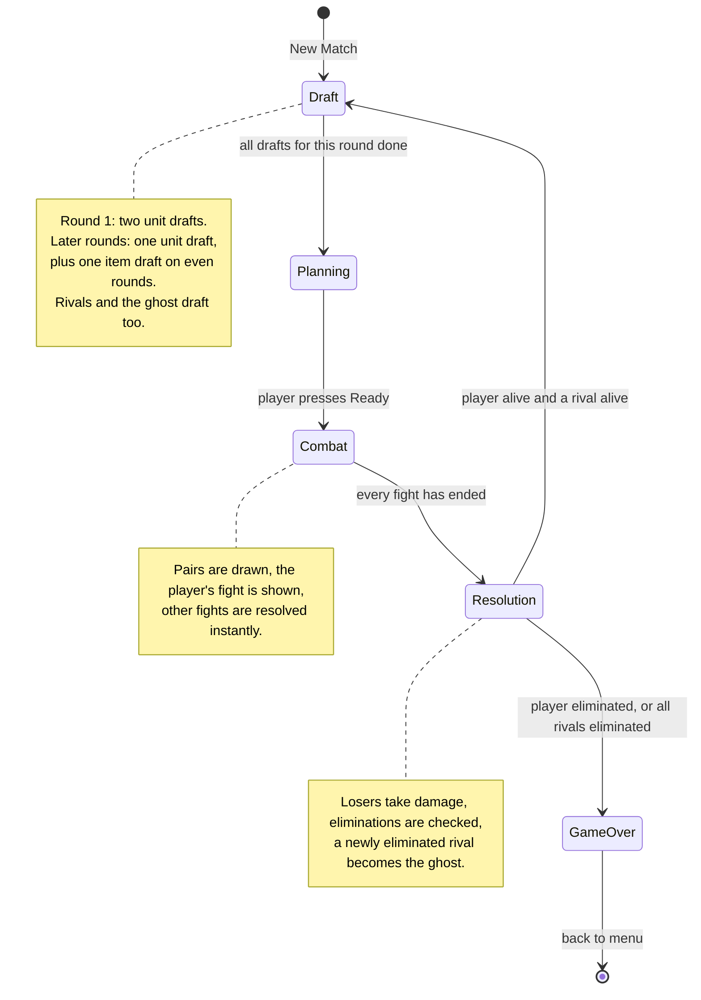

---

## 8. One unit's turn in a tick (sequence diagram)

`Combat.tick()` calls `act()` on every living unit in a fixed order. This is what happens inside one call (GDD section 4.3).

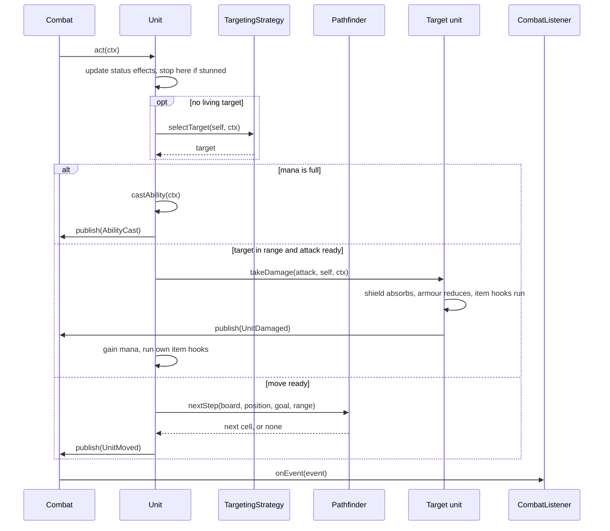

---

## 9. Design patterns summary

| Pattern | Where | Why |
|---|---|---|
| **Template Method** | `Unit.act()` with abstract `castAbility()` | Every unit follows the same tick sequence; only the ability differs. |
| **Strategy** | `TargetingStrategy`; `RivalStrategy`; `Pathfinder` | Swap targeting rules, AI behaviour or the pathfinding algorithm without touching the classes that use them. |
| **State** | `MatchPhase` and its five phases | Each phase knows what it does and which phase comes next, instead of one large `switch` in `Match`. |
| **Factory** | `UnitFactory`, `ItemFactory` | One place that knows how to build each unit and item; the draft and the tests ask for them by type. |
| **Observer** | `CombatListener`, `MatchListener` | The model announces what happened; the interface reacts. Keeps JavaFX out of the model. |
| **Modifier chain** (not a classic catalogue pattern) | `ModifierSource` implemented by `Item`, `Banner`, `StatusEffect` | One uniform way to change stats, so stacking and future traits need no special cases. |

**Object-oriented principles on show**

- **Inheritance and polymorphism:** `Unit` → ten unit classes; `Item` → stat and effect items; `StatusEffect` → shield, burn, stun, buff.
- **Abstraction:** units act through the `CombatContext` interface and never see the `Combat` class.
- **Encapsulation:** a unit's health changes only through `takeDamage()` and `heal()`; a warband enforces the team cap and bench size itself.
- **Composition over inheritance:** targeting, AI behaviour and banners are objects a class *has*, not things it *is*.
